# Azulejo Brutalism

Color scheme/theme for different tools, created by love for Brutalism and Azulejo tilework.

## Install

```sh
./install.sh                 # all tools
./install.sh nvim ghostty    # only some: noteplan, ghostty, herdr, nvim, zed, fastfetch, xcode, vscode, jetbrains, noctalia, obsidian, vibe, helix, mitos
./install.sh --oled          # true-black OLED variant instead of Dark
```

**OLED** is Dark with a pure `#000000` background and near-black surfaces; accents are unchanged. With `--oled` the script sets it as the dark theme in Ghostty, Herdr, Zed, Xcode, Neovim (via `vim.g.azulejo_brutalism_oled = true`), Noctalia (via `pure_black_dark = true`), Vibe (via `theme` in `~/.vibe/config.toml`), Helix, Mitos (as `dark` in the `[theme]` table in `~/.config/mitos/config.toml`) and Obsidian (via the theme's OLED dark toggle in the Style Settings plugin). In NotePlan, VS Code and JetBrains, pick "Azulejo Brutalism OLED" yourself.

Re-run after editing a theme. Edited configs are backed up as `*.bak`.

**Font:** the themes use [JetBrains Mono](https://www.jetbrains.com/lp/mono/) (Nerd Font build, so Neovim and Vibe icons render in the terminal). Install it first with `brew install --cask font-jetbrains-mono-nerd-font`. The script sets it in Ghostty (`font-family`, plus `adjust-cell-height = 10%`), Zed (`buffer_font_family`/`ui_font_family`, rewritten only when already present on one line), Xcode (baked into the themes, line spacing 1.25), JetBrains IDEs (baked into the schemes, size 14, line spacing 1.2, ligatures off) and NotePlan code blocks. Your font size is left alone everywhere; change `FONT` at the top of `install.sh` to use something else.

- **NotePlan:** choose the Light and Dark themes in Settings → Themes.
- **Ghostty:** reload the config with ⌘⇧,
- **Herdr:** the script reloads it for you.
- **Neovim:** becomes LazyVim's colorscheme on the next start.
- **Zed:** switches right away and follows the system appearance.
- **Fastfetch:** run `fastfetch`; the tile uses the terminal's blue and yellow.
- **Xcode:** set automatically if Xcode is closed; otherwise pick them in Settings → Themes.
- **VS Code / Cursor:** restart, then choose Azulejo Brutalism Light/Dark as the preferred light and dark themes.
- **Obsidian:** installed into every vault Obsidian knows about, and set if Obsidian is closed; otherwise pick it in Settings → Appearance → Themes. Its options (OLED dark, uppercase labels, heading rules) are in the Style Settings plugin. Or install it from the community themes (Settings → Appearance → Themes → Manage); the theme lives in [azulejo-brutalism-obsidian](https://github.com/VerticalHeretic/azulejo-brutalism-obsidian), a submodule here.
- **Android Studio / JetBrains:** restart, then pick the scheme in Settings → Editor → Color Scheme (or import the `.icls` from `jetbrains/`).
- **Noctalia:** the palette JSON is copied into `~/.config/noctalia/palettes/` and set as the theme source (`source = "custom"`) in `~/.config/noctalia/config.toml`. Noctalia applies it live, no restart; check with `noctalia config validate`. Light and Dark variants come from the same file; `--oled` turns on `pure_black_dark` for the true-black variant.
- **Mistral Vibe:** installed into Vibe's Python environment (`azulejo_brutalism.py` plus a `.pth` startup hook) and set as `theme` in `~/.vibe/config.toml`. Vibe's TUI is Textual, which has no theme-file format — the hook registers the themes as if they were built-in, so all three variants (light/dark/oled) also appear in Vibe's `/theme` picker. Restart vibe to see it; Python (Textual) TUI only, not the experimental Rust TUI. Uninstall: remove the two `azulejo_brutalism*` files from the `site-packages` shown by the installer. Reinstalling or upgrading mistral-vibe replaces its environment — re-run the script after.
- **Helix:** themes copied to `~/.config/helix/themes/`; `theme` set in `~/.config/helix/config.toml` following the system appearance (Light or Dark, or OLED with `--oled`). Helix has no auto-switch, so after a system appearance change re-run the installer or switch live with `:theme azulejo-brutalism-light|dark|oled`.

## NotePlan

| Light                                        | Dark                                       |
| -------------------------------------------- | ------------------------------------------ |
| 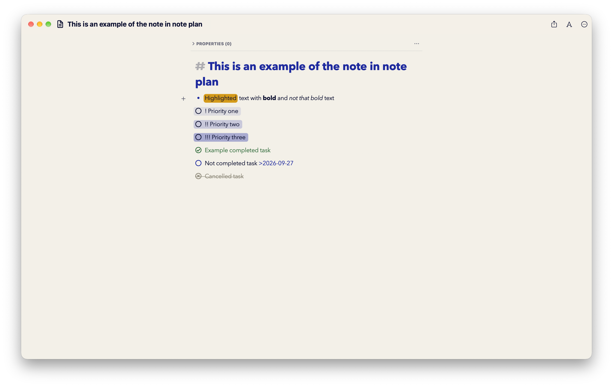 | 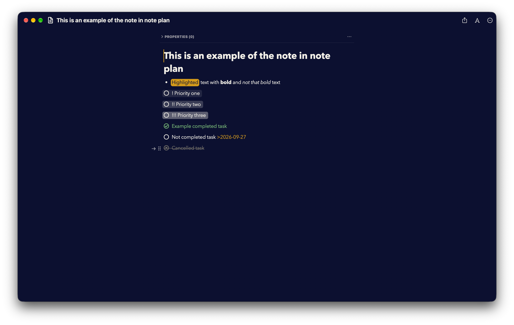 |


## Obsidian

Source and options (OLED, uppercase labels, heading rules via Style Settings): [azulejo-brutalism-obsidian](https://github.com/VerticalHeretic/azulejo-brutalism-obsidian).

## Ghostty + Herdr

| Light                                  | Dark                                 |
| -------------------------------------- | ------------------------------------ |
| 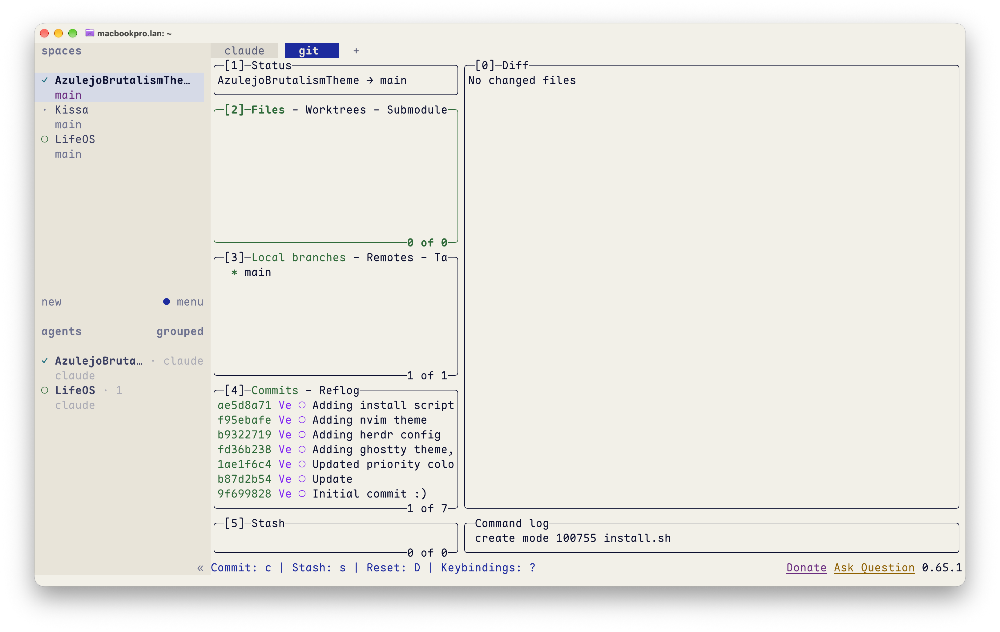 | 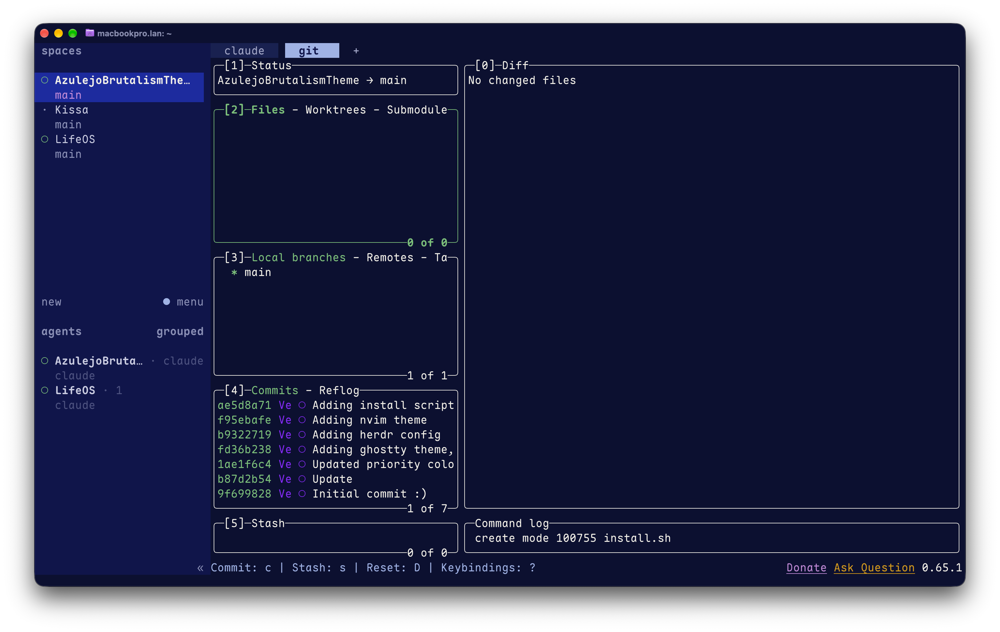 |

## Neovim

| Light                                  | Dark                                 |
| -------------------------------------- | ------------------------------------ |
| 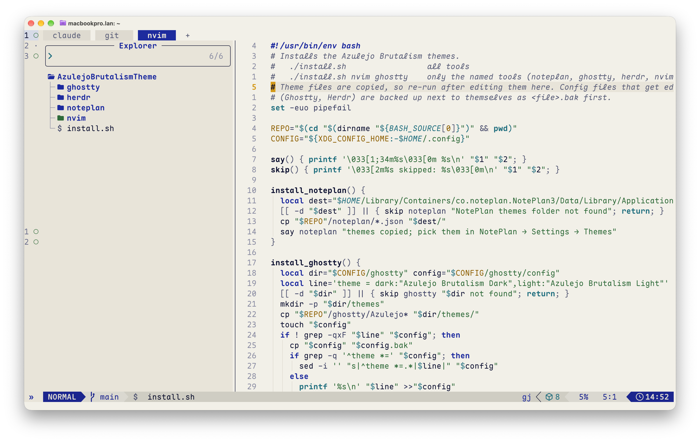 | 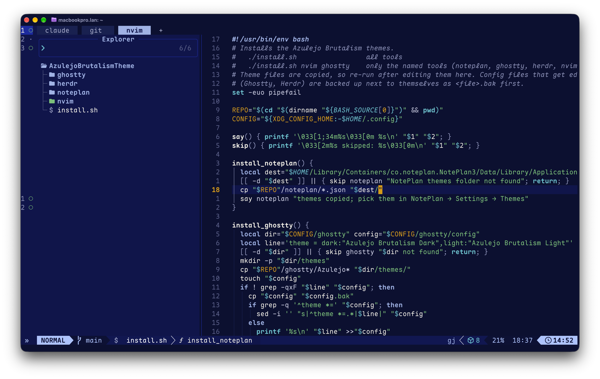 |

## Zed

| Light                              | Dark                             |
| ---------------------------------- | -------------------------------- |
| 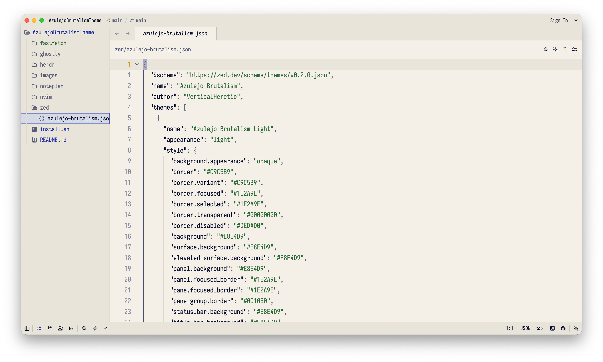 | 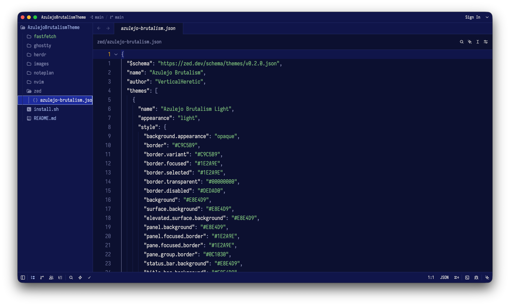 |

## Fastfetch

| Light                                          | Dark                                         |
| ---------------------------------------------- | -------------------------------------------- |
| 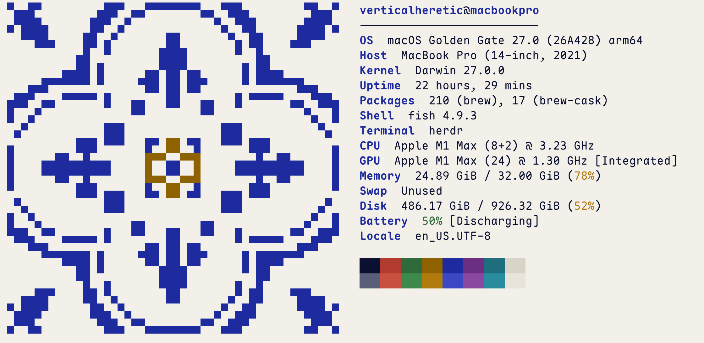 | 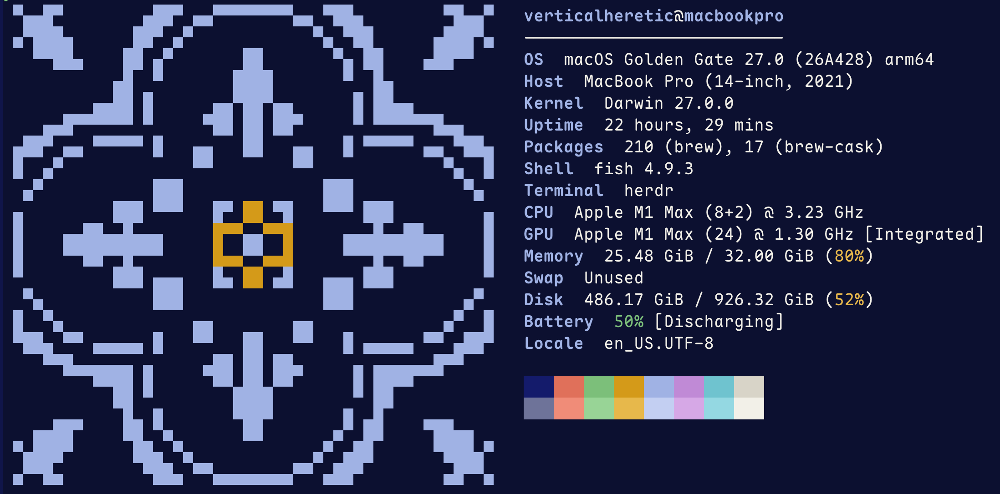 |

## Xcode

| Light                                  | Dark                                 |
| -------------------------------------- | ------------------------------------ |
| 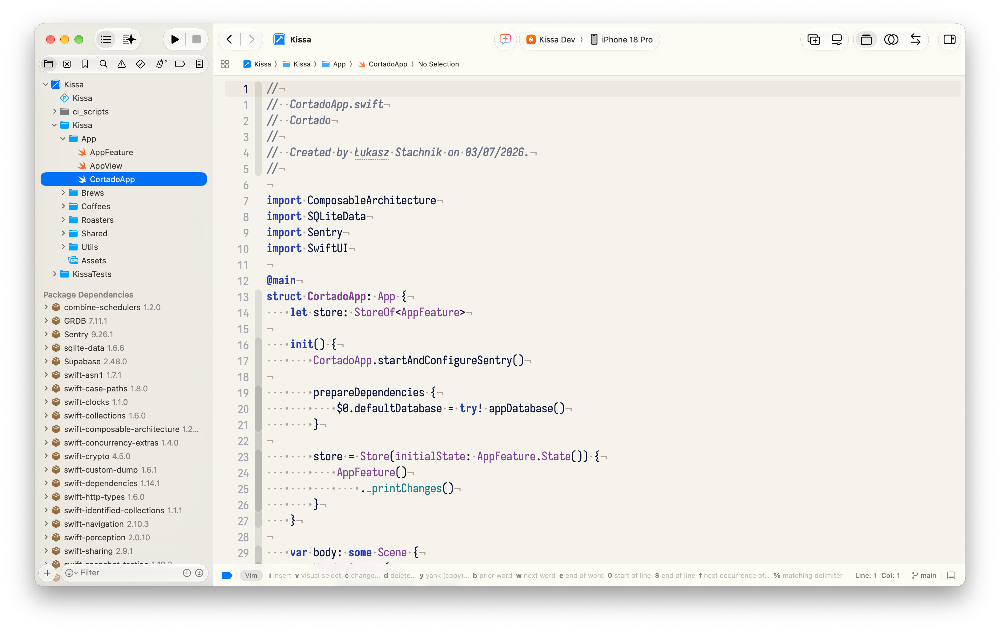 | 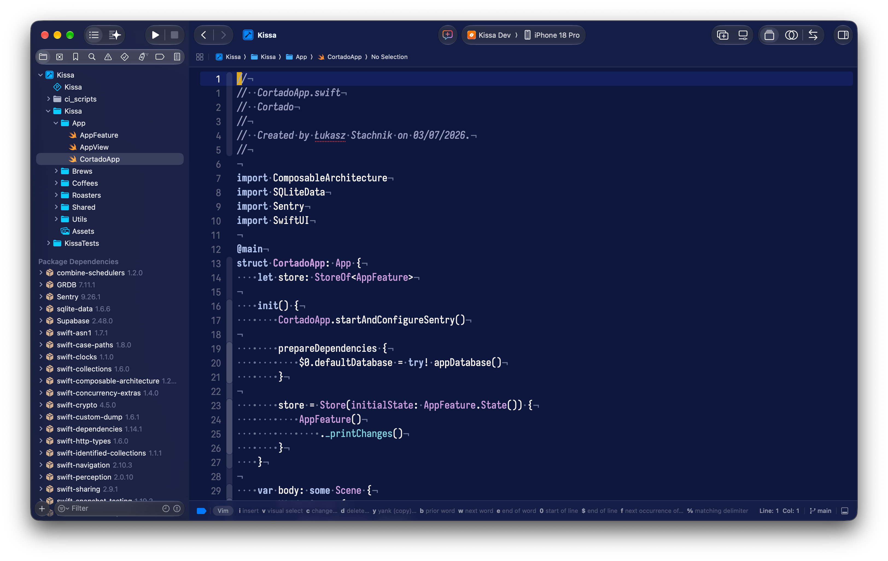 |

